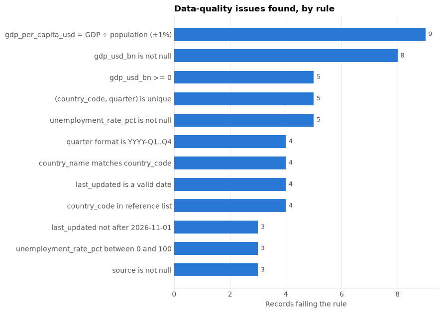

# Data-Quality Validation

A lightweight, repeatable way to check a dataset against documented rules **before** it is used for analysis or reporting, built with Python, pandas and Jupyter.

It scores the data on five data-quality dimensions, lists the exact records that need fixing, and applies a pass/fail **quality gate** that a data pipeline can use to stop bad data from flowing downstream.


**👉 [Open the notebook](notebooks/data_quality_validation.ipynb)** to see the full walkthrough with results. GitHub displays it directly, with no install needed.

## Why it matters

Meaningful research and sound decisions depend on data that is reliable and well governed. Writing quality rules down, and running them every time the data changes, makes expectations visible to business owners and gives data stewards a clear to-do list.

## What it checks

| Dimension | Question it answers | Example rule |
|---|---|---|
| **Completeness** | Is anything missing? | GDP is not null |
| **Uniqueness** | Is any record repeated? | One row per country and quarter |
| **Validity** | Do values follow the rules? | Unemployment is between 0 and 100%; country code is in the reference list |
| **Consistency** | Do related fields agree? | GDP per capita = GDP ÷ population (±1%) |
| **Timeliness** | Are dates realistic? | Last-updated date is not in the future |

## Results on the sample data

16 rules were run against 245 records. **44 records (18%) have at least one issue**, so the dataset **fails** the 95% quality gate.



The full outputs are in [`reports/scorecard.csv`](reports/scorecard.csv) and [`reports/failing_records.csv`](reports/failing_records.csv).

## Project structure

```text
data-quality-validation/
├── data/
│   ├── generate_sample_data.py   # builds the synthetic dataset with known issues
│   └── economic_indicators.csv   # sample data (synthetic)
├── dq/
│   └── checks.py                 # reusable checks + scorecard and reporting helpers
├── notebooks/
│   └── data_quality_validation.ipynb
├── reports/                      # scorecard and failing records written by the notebook
├── docs/                         # images used in this README
└── requirements.txt
```

## Run it yourself

**1. Clone the repo**

```bash
git clone https://github.com/fred-nyanzu/data-quality-validation.git
cd data-quality-validation
```

**2. Create a virtual environment and install the packages**

```bash
python -m venv .venv
```

Activate it. On Windows:

```bash
.venv\Scripts\activate
```

On macOS or Linux:

```bash
source .venv/bin/activate
```

Then install:

```bash
pip install -r requirements.txt
```

**3. (Optional) Regenerate the sample data**

```bash
python data/generate_sample_data.py
```

**4. Open the notebook**

```bash
jupyter notebook notebooks/data_quality_validation.ipynb
```

Then choose **Run → Run All Cells**. The reports are written to `reports/`.

## Use it on your own data

The checks in [`dq/checks.py`](dq/checks.py) work on any pandas DataFrame:

```python
import pandas as pd
from dq import checks

df = pd.read_csv("your_data.csv")

results = [
    checks.not_null(df, "customer_id"),
    checks.unique(df, ["customer_id"]),
    checks.in_range(df, "age", 0, 120),
    checks.allowed_values(df, "country", {"GH", "US", "GB"}),
]

print(checks.scorecard(results))
print(checks.failing_rows(df, results))
```

## Ideas to extend it

- Schedule the checks in **Databricks** and track scores over time.
- Load rules and reference data from a governance catalog such as **Collibra** instead of hard-coding them.
- Record the source system for each failure to support **data lineage** and root-cause analysis.
- Add per-source freshness rules with agreed service levels.

## About the data

The dataset is **synthetic**. It was generated for demonstration and contains issues injected on purpose. The values are not real economic statistics.

## License

[MIT](LICENSE) © Frederick Nyanzu
